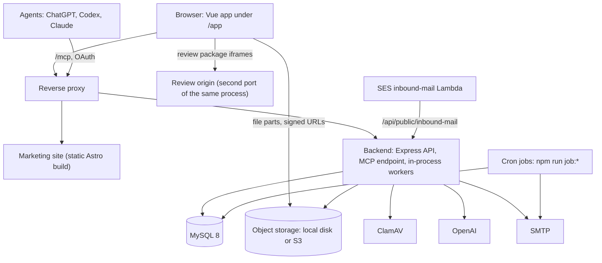

# Architecture

How OdinPMP is put together, as the code stands. The vocabulary is defined in [CONTEXT.md](../CONTEXT.md). [CLAUDE.md](../CLAUDE.md) lists the commands, and the root [README](../README.md) lists every setting.

## What runs

- **Backend** (`backend/`): one Node process. It serves the REST API under `/api`, the MCP endpoint at `/mcp`, and server-sent event streams, and it runs the background workers. It listens on `PORT` (3001), plus `REVIEW_PORT` (3002) when the review origin is on.
- **Frontend** (`frontend/`): a Vue 3 single-page app built by Vite with the base path `/app/`. It only talks to the backend's API.
- **Marketing** (`marketing/`): a static Astro site for the root of the domain. Its access request form posts to `/api/public/waitlist`.
- **Cron jobs:** the mail queue every minute, review reminders every 15 minutes, session cleanup hourly ([tools/README.md](../tools/README.md)).
- **MySQL** holds all state, including the live-event log and the queues. No other database or broker is involved.

## Backend

### Composition

- `src/server.js` builds the MySQL repositories, object storage, mail, the AI providers and the workers, then calls `createApp(deps)` in `src/app.js`.
- `createApp` mounts every module's router. A dependency it doesn't receive falls back to an in-memory version, so most API tests run the whole app without a database.
- `src/config/env.js` validates every setting with Zod at startup and refuses unsafe production values.

### Modules

Each feature lives in `src/modules/<name>/` and keeps the same three layers:

1. **Routes** (`*.routes.js`): Express handlers. They parse the request with a Zod schema and call the service.
2. **Service** (`*.service.js`): permission checks and business rules. Failures are `HttpError`s whose `details.code` the frontend and the MCP tools read.
3. **Repository** (`*.repository.js`): storage, with an in-memory and a MySQL version that share one method list.

Shared code lives in `src/lib/`: auth, events, files, AI clients, logging and HTTP helpers.

### Identity and access

- **People** sign in with a password (with an emailed sign-in code when enabled), Google, or workspace SSO (OIDC or SAML, `src/modules/identity/`). A session is a signed JWT, sent as a bearer token or in an HTTP-only cookie, backed by a row in the sessions table and renewed through a refresh cookie.
- **Workspaces** isolate data. Every query is scoped by the workspace (tenant) id, and a person's role in the workspace and in each project decides what the service allows.
- **People outside the workspace** don't hold accounts:
  - Channel guests sign in with an emailed code and get a guest token (`src/lib/auth/guest-token.js`).
  - Stakeholders reach the requirements portal through private links.
  - A task access link carries its own token.
- **Machines** use OAuth applications and service accounts on `/api/v1`, SCIM 2.0 on `/api/scim/v2`, and OAuth for the MCP endpoint.

### Data and schema

- MySQL holds everything. `backend/db/base-schema.sql` has the base tables. Every later change is a registered migration in `src/jobs/bootstrap-schema.lib.js`, applied in order by `npm run job:bootstrap-schema` and recorded with a checksum in `schema_migrations`.
- A migration is never edited after it has run. Each one must also work with the previous release, because it runs while that release is still serving.
- Request code assumes every migration has run, and never creates tables itself.

### Live updates and events

- **Live events:** a change publishes an event on the live event bus (`src/lib/events/`).
  - Within one process it is an in-memory bus.
  - With more than one backend instance, the shared bus also writes each event to MySQL, and every instance polls for the others' events.
  - Clients receive events over server-sent event streams: workspace, project, chat, assistant chat, requirements, guest and notification streams.
- **Domain event outbox:** changes that other systems must hear about go into the outbox in the same transaction as the change. A dispatcher delivers them with leases and retries, for webhooks and connectors.
- **Project change log:** every write to work items, comments, links, dependencies, sprints and project details adds a row. Agents read it through the change-feed tools.

### Background work

The backend process runs these workers:

| Worker | What it does |
| --- | --- |
| Assistant turn queue and durable worker | Runs AI Workspace turns, and resumes them after a restart |
| File scan worker | Streams each new file to ClamAV and records its SHA-256. A file can't be downloaded until it passes. |
| File preview worker | Converts Office files to PDF previews with LibreOffice (`soffice`) |
| Search index scheduler | Refreshes each workspace's search index (`SEARCH_INDEX_INTERVAL_MS`) |
| Connector workers | Inbound records, ERP sync, outbound sync and erasure requests for connectors |

### Files

- File bytes go to object storage (`src/lib/files/file-storage.js`): local disk under `backend/.data` in development, S3 in production.
- Uploads go in parts. With S3, the browser sends each part straight to the bucket through a signed URL, so the bucket needs CORS rules for the app's origin. With local storage, the same API hands out signed backend URLs instead.
- A file keeps its earlier versions, can be linked to work items, and has an audience: internal (the team) or external (shared with stakeholders).
- **Signing requests** freeze the exact versions of their documents (SHA-256). Each signature record is sealed with an HMAC under a server key (`src/modules/signing/`).

### AI

- **Assistant and MCP:** the AI Workspace assistant (`src/modules/assistant/`) and the MCP tools (`src/mcp/`) act by calling Odin's own REST routes as the signed-in person. Permissions, versions, workflow rules and notifications are therefore the same as in the UI. [docs/assistant.md](assistant.md) describes the assistant's turns, and [docs/mcp.md](mcp.md) the tool catalog.
- **Requirements AI:** it drafts questions, summaries and plans through prompts listed in [docs/ai-prompts-inventory.md](ai-prompts-inventory.md). Tests check that the list matches the code.
- **Embeddings:** search embeds work items, comments, posts and file text. The assistant's memory has its own embeddings. Vectors are stored in MySQL and scored in Node.
- **Keys:** each workspace can use its own OpenAI key and models, and falls back to the server's `OPENAI_API_KEY`.

### Mail and notifications

- **Outgoing mail:** queued in MySQL and sent over SMTP by `job:mail-queue`, which also rolls up the digests: clarification invitations, requirements mentions and chat.
- **Replies by email:** reply-by-email for clarifications and Bug Reporter threads arrives through the SES Lambda in `tools/clarification-inbound-lambda/`, which posts each message to `/api/public/inbound-mail`.
- **Browser push:** Web Push uses VAPID keys. The service worker (`frontend/public/sw.js`) shows the notification and opens it in an existing tab.

### Review origin

Review packages (stakeholder-facing screens and prototypes) are served by a second Express app (`src/review-origin/`) on its own host and port.

- Their HTML never runs on the app's origin.
- The app embeds them through short-lived grants.
- The package contract is in [docs/requirements-gathering/](requirements-gathering/package-spec.md).

## Frontend

- `src/router/index.js` maps each route to a view in `src/views/`. Components are grouped by feature in `src/components/`.
- Logic lives in `src/lib/<feature>/`, apart from the components, so that `node --test` can cover it. The API client is `src/lib/api/client.js`, and live updates come from `src/lib/live/`.
- Rich text uses one Tiptap editor (`components/rich-content/RichContentEditor.vue`):
  - Comments and channel posts are stored as Markdown with inline mention tokens such as `@[Name](user:<id>)`.
  - Descriptions are stored as sanitized HTML.
- Browser tests (`e2e/`) run against mocked API fixtures and never reach a backend.

## Services outside this repository

- **Bug Reporter** and **FaultLine** run as separate services that use Odin's projects, sign-in and mail. A Bug Reporter report becomes an Odin ticket.
- **invoice-gen** supplies the SOW, invoices and milestone hours that the Consulting module's billing reads (`INVOICE_GEN_BASE_URL`).
